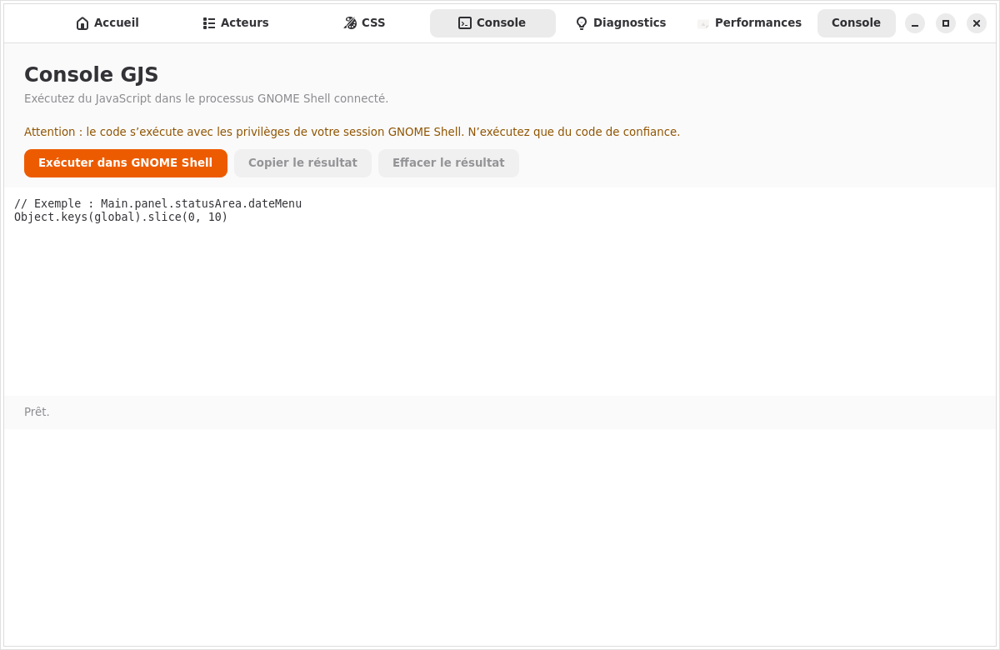

# GNOME Inspector

A native developer tool for inspecting and debugging GNOME Shell.

**Current version: `0.1.0-alpha.1`.** The first distributable Linux alpha archive can be built
with `bash scripts/package-alpha.sh`. Published binaries will be attached to a draft GitHub release.

The first development target is GNOME Shell 51 on Linux. The project uses a GTK4/libadwaita
desktop application and a GNOME Shell extension. The extension is the only component
that accesses Shell-specific APIs.

## Current status

- [x] Rust + GTK4/libadwaita desktop application
- [x] GNOME Shell 51 extension
- [x] Session D-Bus name and version handshake
- [x] Bounded Shell actor-tree snapshot (JSON)
- [x] Native application shell with adaptive libadwaita navigation tabs in the HeaderBar
- [x] Actor hierarchy navigation with expand/collapse, contextual search, readable property inspection, and actor-path copying
- [x] Live actor selection from GNOME Shell with actor highlighting and synchronized tree selection
- [x] Dedicated property editor for writable string, boolean and numeric GObject properties
- [x] Actor CSS classes, pseudo-classes and inline-style snapshots
- [x] Computed actor theme metrics (font, dimensions, spacing and CSS node identity)
- [x] Explicit per-actor inline CSS editing
- [x] Active theme stylesheet discovery and custom stylesheet reload
- [x] Per-actor CSS class editing
- [x] User-owned custom CSS editor with GNOME Shell apply/rollback
- [x] Per-user build, install, desktop launcher and uninstall scripts
- [ ] Global theme stylesheet editing
- [x] Interactive GJS console (explicit code execution, 50-command history with Up/Down navigation)
- [x] GNOME Shell session diagnostics
- [x] Shell scene capture metrics (duration, actor count, stage and monitors)
- [x] Rolling rendered-frame-rate history (last 60 samples)
- [ ] CPU and memory history

The Shell agent exposes a validated `SetActorProperty` D-Bus method for writable GObject properties. The Actors panel lists supported writable string, boolean and numeric properties for the selected actor, pre-fills the current value, and applies edits over D-Bus. The Shell agent rejects read-only or unsupported properties and enforces numeric property bounds. The actor snapshot is read-only and deliberately bounded to 1,000 actors and 12 levels.
Its response includes an actor count, a truncation flag, and an `incomplete` flag when
an actor property or child list cannot be read. Per-actor `propertyErrors`, `childrenError`,
and `actorError` fields explain failures. Invalid geometry uses safe fallback values, and
repeated actor references are reported instead of being traversed again. The desktop app uses a libadwaita ViewSwitcher in the HeaderBar to navigate between six modules without a permanent sidebar. The GJS console provides explicit run, copy-result and clear-result actions; its persistent drawer follows new output automatically. The default window size gives the inspector panels more room while remaining resizable. Actor-specific CSS editors and copy-path actions stay disabled until an actor is selected, and inspector panes explain what to do before the first selection. The desktop app currently provides a navigable workspace for Overview, Actors, CSS and themes,
GJS Console, Diagnostics, and Performance. The actor module keeps the selected stable path after
refreshing its hierarchy and falls back to the root actor if that selection disappears. The
multiline GJS editor supports Ctrl+Enter to execute; copy and clear actions are enabled only when
a result is available. The actor module displays the hierarchy as a selectable,
expandable list. Searching matches actor names, types, and readable GObject property names or values; it expands the hierarchy and retains ancestor rows when a descendant matches,
so matching actors remain visible in their tree context; clearing the search restores the default
collapsed state. Selecting an actor shows a focused, human-readable property summary rather than repeating its descendant subtree, including up to 64 readable GObject properties with type, read/write flags, error details and safely summarized values. The property panel can filter those entries by property name, type or value, and edit supported writable properties directly with validation in the Shell agent. The **Sélectionner dans Shell** action starts a 15-second visual picker: click an actor in GNOME Shell to select it, press Escape to cancel, and the desktop tree follows the selected stable child-index path. The selected actor is highlighted with a temporary blue outline. The CSS module retrieves style classes, pseudo-classes and inline styles over D-Bus, presents a searchable actor list filtered by actor name, CSS classes or stable child-index path, preserves the selected actor and its editable fields when refreshing the snapshot, and exposes computed theme-node metrics (font, dimensions, spacing and CSS node identity) in a property-oriented view with case-insensitive filtering by property name or value, and supports explicit class and inline-style updates for the selected actor. Updates are limited to 512 characters for class lists and 4,096 characters for inline CSS, and resolve actors through a bounded child-index path. Active application, theme, default and custom stylesheet paths can be discovered; custom stylesheets can be reloaded after external edits. The CSS panel includes a small editor for a user-owned `custom.css` stored in `$XDG_CONFIG_HOME/gnome-inspector/custom.css` (or `~/.config/gnome-inspector/custom.css`). Saving applies the stylesheet through GNOME Shell and restores the previous file if GNOME rejects it; the editor is limited to 64 KiB and never modifies system or global theme files. The performance module presents scene-capture duration, actor count, stage dimensions, monitor count and rendered frames per second in a native dashboard, with a readable rolling 60-sample history. The frame rate is aggregated across monitor views. Rendered-frame events are aggregated across monitor views; CPU and memory history remain to be implemented. The GJS console executes user-supplied code in the connected Shell process; it is intentionally powerful and must only be used with trusted code. The Diagnostics module retrieves the Shell version, session/display environment, stage dimensions, monitor count, and extension metadata from the live Shell agent.

## Screenshots

These images are captured from the running GTK application in CI using a virtual X11
display and a deterministic mock GNOME Shell D-Bus service. Each image shows its module
selected in the HeaderBar. They show the real application interface with representative
inspection data; the mock service is only used for these documentation captures.

| Module | Screenshot |
| --- | --- |
| Overview and connection status |  |
| Actor hierarchy and properties |  |
| CSS classes, inline styles and themes |  |
| GJS console |  |
| GNOME Shell diagnostics |  |
| Performance dashboard and history |  |

The PNG files are versioned in `screenshots/`, so they are displayed directly on
GitHub and remain available independently of CI artifact retention. GitHub Actions regenerates them with `scripts/capture-readme-screenshots.sh` on each CI run
and uploads the `gnome-inspector-readme-screenshots` artifact for review. The committed
images are updated only when the workflow is started manually with
`workflow_dispatch`; a normal push checks the captures but does not commit them.

## Install GNOME Inspector

### Install a prebuilt alpha archive

Download and extract the `gnome-inspector-0.1.0-alpha.1-linux-ARCH.tar.gz` archive from the
GitHub Releases page, then run these commands from the extracted directory:

```sh
./install.sh
```

Before copying files, the installer verifies GNOME Shell 51 and checks that all shared libraries required by the binary are available.

The archive contains the prebuilt application, GNOME Shell extension, runtime checker, README, changelog, license,
and matching install/uninstall scripts. It does not require Cargo or Rust. GNOME Shell
51 and `gnome-extensions` are still required. Remove it with `./uninstall.sh`; user
configuration is preserved.

### Build and install from source

From the repository root, install the application and its GNOME Shell agent for the
current user:

```sh
bash scripts/install.sh
```

The installer builds the optimized Rust application, installs it to `~/.local/bin`,
creates a desktop-menu entry in `$XDG_DATA_HOME/applications`, and installs/enables
the Shell extension. It does not require root privileges. The script checks that Cargo, GNOME Shell 51, `gnome-extensions`, and the binary runtime libraries are available before installation. Launch GNOME Inspector
from the application menu or run `gnome-inspector`.

To remove the application and extension:

```sh
bash scripts/uninstall.sh
```

The uninstaller preserves `$XDG_CONFIG_HOME/gnome-inspector`, including the custom
stylesheet. To install or update only the Shell agent from a development checkout,
use `bash scripts/install-extension.sh`. That script copies the extension to
`~/.local/share/gnome-shell/extensions/gnome-inspector@cgreg21`, and checks whether
GNOME Shell has discovered it before requesting activation. If the extension is not
listed yet, log out and back in, then enable it manually with:

```sh
gnome-extensions enable gnome-inspector@cgreg21
```

Open GNOME Inspector and use **Tester la connexion** on the Overview page. If
the extension is not discovered after installation, log out and back in so GNOME
Shell rescans the extensions directory. The app reports this situation separately
from an activation error.

## Security and alpha limitations

**GJS console warning:** the console evaluates entered JavaScript inside the connected GNOME Shell process, with that process's privileges. A command can change or disrupt the desktop session and may access data available to GNOME Shell. Run only code you have reviewed and trust. Do not paste commands from untrusted sources.

This alpha targets GNOME Shell 51. The current release workflow builds Linux x86_64 archives; other architectures are not yet packaged. Performance reporting does not include CPU or memory history, and actor inspection is bounded and may report incomplete snapshots. See [CHANGELOG.md](CHANGELOG.md) for the alpha feature list and known limitations.

## Requirements

- Rust stable and Cargo
- GTK 4 development files
- libadwaita development files
- GNOME Shell 51

Install the native build dependencies with your distribution's package manager:

**Debian / Ubuntu / Linux Mint**
```sh
sudo apt update
sudo apt install build-essential pkg-config libgtk-4-dev libadwaita-1-dev
```

**Fedora**
```sh
sudo dnf install gcc gcc-c++ make pkgconf-pkg-config gtk4-devel libadwaita-devel
```

**RHEL / Rocky Linux / AlmaLinux**

Enable the repositories that provide GNOME development packages (typically AppStream and CRB/CodeReady Builder), then install:
```sh
sudo dnf install gcc gcc-c++ make pkgconf-pkg-config gtk4-devel libadwaita-devel
```

Package availability and versions depend on the enabled RHEL-compatible repositories.

**Arch Linux / Manjaro**
```sh
sudo pacman -S --needed base-devel pkgconf gtk4 libadwaita
```

**openSUSE Tumbleweed / Leap**
```sh
sudo zypper install gcc gcc-c++ make pkg-config gtk4-devel libadwaita-devel
```

**Alpine Linux**
```sh
sudo apk add build-base pkgconf gtk4.0-dev libadwaita-dev
```

**Gentoo**
```sh
sudo emerge --ask dev-util/pkgconf dev-lang/rust x11-libs/gtk+:4 gui-libs/libadwaita
```

Install Rust stable and Cargo if they are not already available, preferably through
[rustup](https://rustup.rs/) when the distribution's packaged compiler is too old:
```sh
rustup toolchain install stable
rustup default stable
```

The package names above provide the GTK 4 and libadwaita development libraries plus
the C toolchain and pkg-config metadata needed by Cargo's native bindings. GNOME Shell
51 is required to run and test the extension, but is not needed just to compile the
GTK desktop application.

## Build and run

```sh
cargo build
cargo run
```

Run checks and diagnostics:

```sh
cargo fmt --all -- --check
cargo check --all-targets --all-features
RUST_BACKTRACE=full cargo test --all-targets --all-features -- --nocapture
cargo test --doc --all-features
cargo clippy --all-targets --all-features -- -D warnings
node --test --test-reporter=spec extension/*.test.js
bash scripts/test-install.sh
bash scripts/test-package.sh
bash scripts/test-runtime.sh
bash scripts/test-release-tag.sh
shellcheck scripts/test-gnome-shell-51.sh scripts/test-install.sh scripts/test-package.sh scripts/test-runtime.sh scripts/test-release-tag.sh scripts/check-release-tag.sh scripts/check-runtime.sh scripts/package-alpha.sh scripts/install-bundle.sh scripts/uninstall-bundle.sh scripts/capture-readme-screenshots.sh scripts/install-extension.sh scripts/install.sh scripts/uninstall.sh
```

CI additionally runs:

- **cargo-nextest** for the Rust test suite.
- **cargo-llvm-cov** and publishes the LCOV coverage report.
- **cargo-audit** against the RustSec advisory database.
- **cargo-machete** to detect unused direct dependencies.
- **cargo tree --duplicates** to expose duplicate dependency versions.
- JavaScript syntax and extension metadata validation.
- ShellCheck and actionlint for the CI, installation, and integration scripts.
- A real GNOME Shell 51 extension integration test (see below).

## GNOME Shell 51 virtual test session

The `gnome-shell-51-virtual-session` CI job uses Fedora 45, whose packaged GNOME Shell
is version 51. It launches an isolated, headless GNOME Shell process inside a private
D-Bus session. This is a virtual Shell runtime, not a full virtual-machine boot or a
complete GDM login session.

The test installs and enables the extension in a temporary home directory, then checks:

1. The Shell process is actually GNOME Shell 51.
2. The extension loads and owns its D-Bus service.
3. `Ping` returns the Shell version.
4. `GetActorTree` returns the expected bounded JSON snapshot.
5. `GetStyleTree`, `GetDiagnostics`, `EvaluateGjs`, and `GetPerformance` respond.
6. Visual actor picker can start, report its pending state, and cancel cleanly.
7. Actor snapshots expose GObject property metadata.
8. Invalid CSS actor and class paths are rejected.
9. The Shell log contains no GJS extension errors or criticals.

The mocked logind service log is uploaded alongside the Shell log for diagnostics.

The job uploads `gnome-shell-51.log` even when the test fails, so startup and extension
errors remain available for diagnosis. Run the same test locally on Fedora 45 with:

```sh
dbus-run-session -- bash scripts/test-gnome-shell-51.sh
```

The CI session uses the headless Mutter backend; it validates the Shell process and
extension/D-Bus integration, but it does not replace manual testing on a graphical
Wayland session with real input and display hardware.

## D-Bus interface

- Bus name: `io.github.cgreg21.GnomeInspector.Shell`
- Object path: `/io/github/cgreg21/GnomeInspector`
- Interface: `io.github.cgreg21.GnomeInspector`
- `Ping() -> s`: running GNOME Shell version
- `StartActorPicker() -> s`, `GetActorPickerResult() -> s`, `CancelActorPicker() -> s`: start, inspect, and cancel visual actor selection
- `GetActorTree() -> s`: bounded JSON snapshot of the Shell stage and its descendants,
  including truncation, incomplete-capture status, and per-property failure details
- `GetStyleTree() -> s`: bounded actor CSS snapshot with stable child-index paths
- `GetActorComputedStyle(s) -> s`: computed theme-node metrics for one actor (physical-pixel dimensions and spacing)
- `GetThemeInfo() -> s`: active application, theme, default and custom stylesheet paths
- `GetCustomStylesheet() -> s`: read the user-owned custom stylesheet
- `SaveCustomStylesheet(s) -> s`: validate and save/apply user CSS (64 KiB maximum)
- `ReloadCustomStylesheets() -> s`: reload active custom stylesheets
- `SetActorProperty(sss) -> s`: update a validated writable string, boolean or numeric GObject property for an actor path
- `SetActorStyleClass(ss) -> s`: explicitly update an actor's CSS class list (512-character limit)
- `SetActorInlineStyle(ss) -> s`: explicitly update one actor's inline CSS (4,096-character limit)
- `GetDiagnostics() -> s`: report session, stage, monitor, and extension information
- `EvaluateGjs(s) -> s`: execute trusted JavaScript in the Shell process
- `GetPerformance() -> s`: measure actor snapshot duration and report scene dimensions

## Design constraints

- Keep the implementation KISS: no speculative framework or plugin architecture.
- Rust owns the desktop application and general-purpose logic.
- GJS is limited to the GNOME Shell extension and Shell-specific APIs.
- Prefer GNOME/GLib APIs over custom infrastructure.
- Inspection is read-only by default; mutations must be explicit.
- A feature is not complete until it has meaningful tests.

## License

MIT. See [LICENSE](LICENSE).
