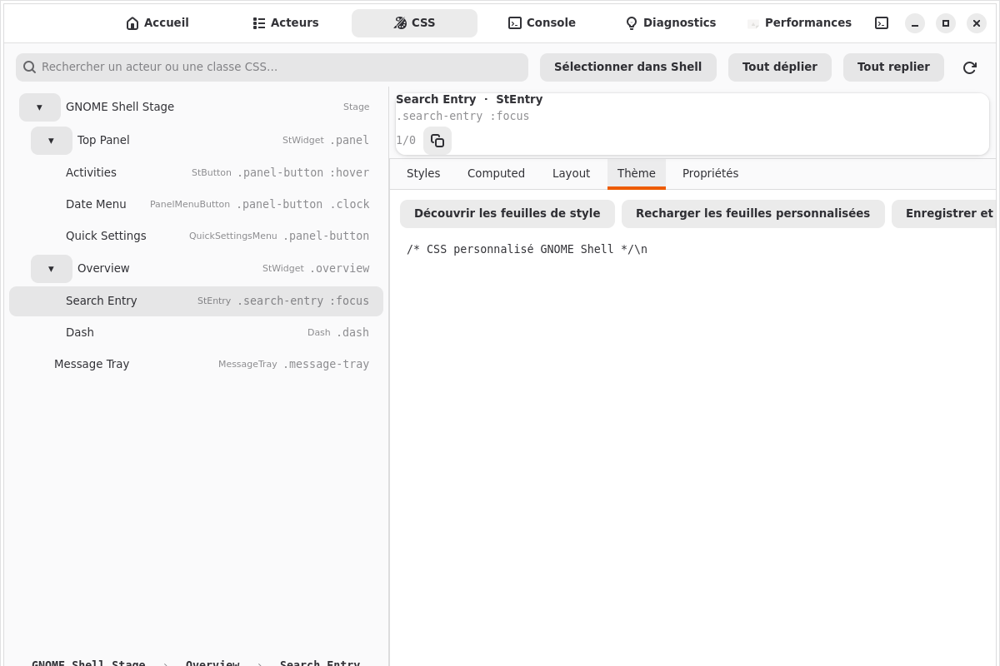

# GNOME Inspector

A native developer tool for inspecting and debugging GNOME Shell.

The first development target is GNOME Shell 51 on Linux. The project uses a GTK4/libadwaita
desktop application and a GNOME Shell extension. The extension is the only component
that accesses Shell-specific APIs.

## Current status

- [x] Rust + GTK4/libadwaita desktop application
- [x] GNOME Shell 51 extension
- [x] Session D-Bus name and version handshake
- [x] Bounded Shell actor-tree snapshot (JSON)
- [x] Native application shell with adaptive libadwaita navigation tabs in the HeaderBar
- [x] Actor hierarchy navigation and property JSON inspection
- [ ] Dedicated property editor and live actor selection
- [x] Actor CSS classes, pseudo-classes and inline-style snapshots
- [x] Computed actor theme metrics (font, dimensions, spacing and CSS node identity)
- [x] Explicit per-actor inline CSS editing
- [x] Active theme stylesheet discovery
- [x] Per-actor CSS class editing
- [ ] Global theme stylesheet editing
- [x] Interactive GJS console (explicit code execution)
- [x] GNOME Shell session diagnostics
- [x] Shell scene capture metrics (duration, actor count, stage and monitors)
- [x] Rolling rendered-frame-rate history (last 60 samples)
- [ ] CPU and memory history

The actor snapshot is read-only and deliberately bounded to 1,000 actors and 12 levels.
Its response includes an actor count, a truncation flag, and an `incomplete` flag when
an actor property or child list cannot be read. Per-actor `propertyErrors`, `childrenError`,
and `actorError` fields explain failures. Invalid geometry uses safe fallback values, and
repeated actor references are reported instead of being traversed again. The desktop app uses a libadwaita ViewSwitcher in the HeaderBar to navigate between six modules without a permanent sidebar. The desktop app currently provides a navigable workspace for Overview, Actors, CSS and themes,
GJS Console, Diagnostics, and Performance. The actor module displays the hierarchy as a selectable list, filters actors by their displayed name or type, and shows the selected actor's properties as formatted JSON. The CSS module retrieves style classes, pseudo-classes and inline styles over D-Bus, presents a searchable actor list filtered by actor name or CSS classes with stable selection while filtering, exposes computed theme-node metrics (font, dimensions, spacing and CSS node identity), and supports explicit class and inline-style updates for the selected actor. Updates are limited to 512 characters for class lists and 4,096 characters for inline CSS, and resolve actors through a bounded child-index path. Active application, theme, default and custom stylesheet paths can be discovered; editing global theme stylesheets remains to be implemented. The performance module presents scene-capture duration, actor count, stage dimensions, monitor count and rendered frames per second in a native dashboard, with a readable rolling 60-sample history. The frame rate is aggregated across monitor views. Rendered-frame events are aggregated across monitor views; CPU and memory history remain to be implemented. The GJS console executes user-supplied code in the connected Shell process; it is intentionally powerful and must only be used with trusted code. The Diagnostics module retrieves the Shell version, session/display environment, stage dimensions, monitor count, and extension metadata from the live Shell agent.

## Screenshots

These images are captured from the running GTK application in CI using a virtual X11
display and a deterministic mock GNOME Shell D-Bus service. They show the real application
interface with representative inspection data; the mock service is only used for these
documentation captures.

| Module | Screenshot |
| --- | --- |
| Overview and connection status |  |
| Actor hierarchy and properties |  |
| CSS classes, inline styles and themes |  |
| GJS console |  |
| GNOME Shell diagnostics |  |
| Performance dashboard and history |  |

The PNG files are versioned in `screenshots/`, so they are displayed directly on
GitHub and remain available independently of CI artifact retention. GitHub Actions
regenerates them with `scripts/capture-readme-screenshots.sh`, commits updated captures,
and also uploads the `gnome-inspector-readme-screenshots` artifact for review.

## Requirements

- Rust stable and Cargo
- GTK 4 development files
- libadwaita development files
- GNOME Shell 51

Install the native build dependencies with your distribution's package manager:

**Debian / Ubuntu / Linux Mint**
```sh
sudo apt update
sudo apt install build-essential pkg-config libgtk-4-dev libadwaita-1-dev
```

**Fedora**
```sh
sudo dnf install gcc gcc-c++ make pkgconf-pkg-config gtk4-devel libadwaita-devel
```

**RHEL / Rocky Linux / AlmaLinux**

Enable the repositories that provide GNOME development packages (typically AppStream and CRB/CodeReady Builder), then install:
```sh
sudo dnf install gcc gcc-c++ make pkgconf-pkg-config gtk4-devel libadwaita-devel
```

Package availability and versions depend on the enabled RHEL-compatible repositories.

**Arch Linux / Manjaro**
```sh
sudo pacman -S --needed base-devel pkgconf gtk4 libadwaita
```

**openSUSE Tumbleweed / Leap**
```sh
sudo zypper install gcc gcc-c++ make pkg-config gtk4-devel libadwaita-devel
```

**Alpine Linux**
```sh
sudo apk add build-base pkgconf gtk4.0-dev libadwaita-dev
```

**Gentoo**
```sh
sudo emerge --ask dev-util/pkgconf dev-lang/rust x11-libs/gtk+:4 gui-libs/libadwaita
```

Install Rust stable and Cargo if they are not already available, preferably through
[rustup](https://rustup.rs/) when the distribution's packaged compiler is too old:
```sh
rustup toolchain install stable
rustup default stable
```

The package names above provide the GTK 4 and libadwaita development libraries plus
the C toolchain and pkg-config metadata needed by Cargo's native bindings. GNOME Shell
51 is required to run and test the extension, but is not needed just to compile the
GTK desktop application.

## Build and run

```sh
cargo build
cargo run
```

Run checks and diagnostics:

```sh
cargo fmt --all -- --check
cargo check --all-targets --all-features
RUST_BACKTRACE=full cargo test --all-targets --all-features -- --nocapture
cargo test --doc --all-features
cargo clippy --all-targets --all-features -- -D warnings
node --test --test-reporter=spec extension/*.test.js
shellcheck scripts/test-gnome-shell-51.sh
```

CI additionally runs:

- **cargo-nextest** for the Rust test suite.
- **cargo-llvm-cov** and publishes the LCOV coverage report.
- **cargo-audit** against the RustSec advisory database.
- **cargo-machete** to detect unused direct dependencies.
- **cargo tree --duplicates** to expose duplicate dependency versions.
- JavaScript syntax and extension metadata validation.
- ShellCheck and actionlint for the CI/integration scripts.
- A real GNOME Shell 51 extension integration test (see below).

## GNOME Shell 51 virtual test session

The `gnome-shell-51-virtual-session` CI job uses Fedora 45, whose packaged GNOME Shell
is version 51. It launches an isolated, headless GNOME Shell process inside a private
D-Bus session. This is a virtual Shell runtime, not a full virtual-machine boot or a
complete GDM login session.

The test installs and enables the extension in a temporary home directory, then checks:

1. The Shell process is actually GNOME Shell 51.
2. The extension loads and owns its D-Bus service.
3. `Ping` returns the Shell version.
4. `GetActorTree` returns the expected bounded JSON snapshot.
5. `GetStyleTree`, `GetDiagnostics`, `EvaluateGjs`, and `GetPerformance` respond.
6. Invalid CSS actor and class paths are rejected.
7. The Shell log contains no GJS extension errors or criticals.

The mocked logind service log is uploaded alongside the Shell log for diagnostics.

The job uploads `gnome-shell-51.log` even when the test fails, so startup and extension
errors remain available for diagnosis. Run the same test locally on Fedora 45 with:

```sh
dbus-run-session -- bash scripts/test-gnome-shell-51.sh
```

The CI session uses the headless Mutter backend; it validates the Shell process and
extension/D-Bus integration, but it does not replace manual testing on a graphical
Wayland session with real input and display hardware.

## Install the development extension

Copy `extension/` to:

```
~/.local/share/gnome-shell/extensions/gnome-inspector@cgreg21/
```

Then log out and back in (or restart GNOME Shell where supported), and enable it:

```sh
gnome-extensions enable gnome-inspector@cgreg21
```

Start GNOME Inspector. Use **Tester la connexion** if the extension was enabled after
the application started, and the refresh buttons in each module to request fresh snapshots.

## D-Bus interface

- Bus name: `io.github.cgreg21.GnomeInspector.Shell`
- Object path: `/io/github/cgreg21/GnomeInspector`
- Interface: `io.github.cgreg21.GnomeInspector`
- `Ping() -> s`: running GNOME Shell version
- `GetActorTree() -> s`: bounded JSON snapshot of the Shell stage and its descendants,
  including truncation, incomplete-capture status, and per-property failure details
- `GetStyleTree() -> s`: bounded actor CSS snapshot with stable child-index paths
- `GetActorComputedStyle(s) -> s`: computed theme-node metrics for one actor (physical-pixel dimensions and spacing)
- `GetThemeInfo() -> s`: active application, theme, default and custom stylesheet paths
- `SetActorStyleClass(ss) -> s`: explicitly update an actor's CSS class list (512-character limit)
- `SetActorInlineStyle(ss) -> s`: explicitly update one actor's inline CSS (4,096-character limit)
- `GetDiagnostics() -> s`: report session, stage, monitor, and extension information
- `EvaluateGjs(s) -> s`: execute trusted JavaScript in the Shell process
- `GetPerformance() -> s`: measure actor snapshot duration and report scene dimensions

## Design constraints

- Keep the implementation KISS: no speculative framework or plugin architecture.
- Rust owns the desktop application and general-purpose logic.
- GJS is limited to the GNOME Shell extension and Shell-specific APIs.
- Prefer GNOME/GLib APIs over custom infrastructure.
- Inspection is read-only by default; mutations must be explicit.
- A feature is not complete until it has meaningful tests.

## License

MIT. See [LICENSE](LICENSE).
