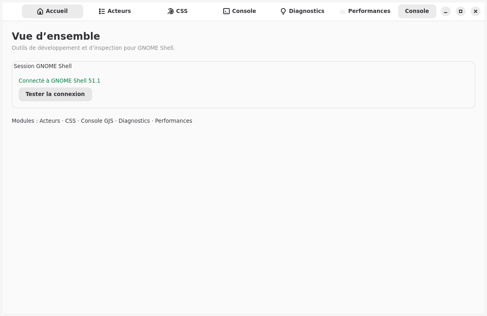
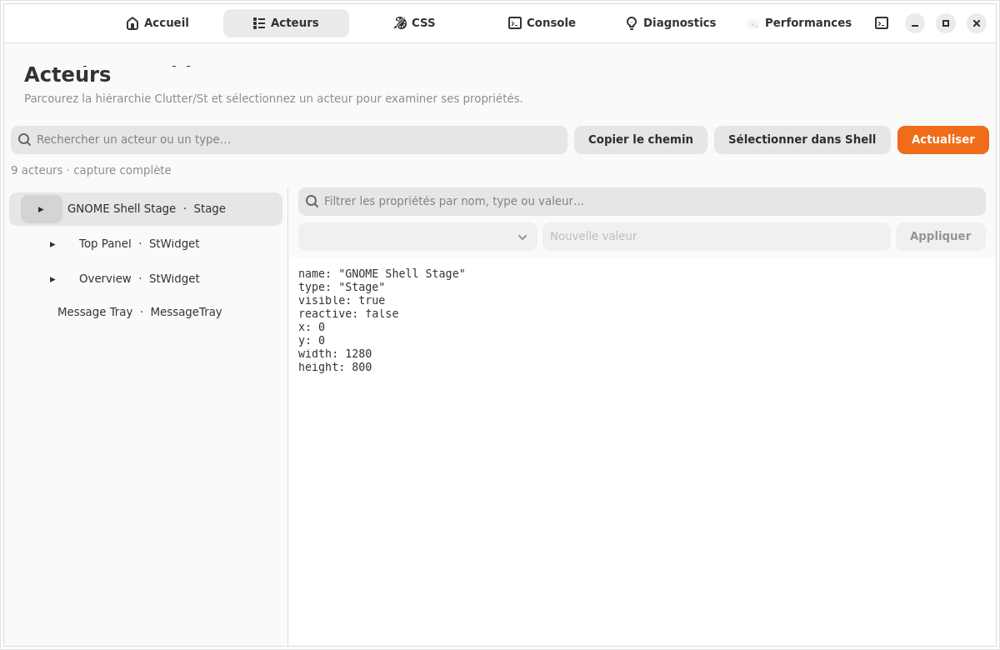
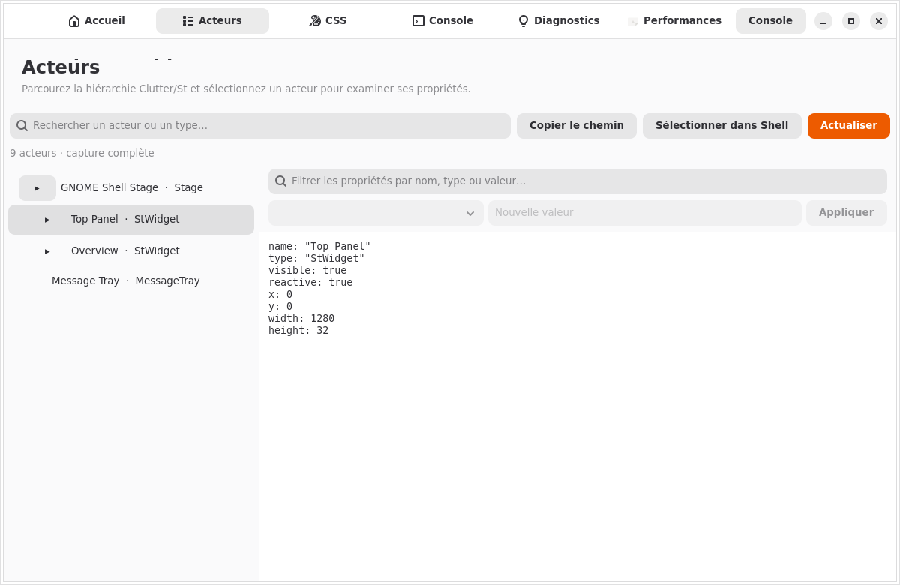
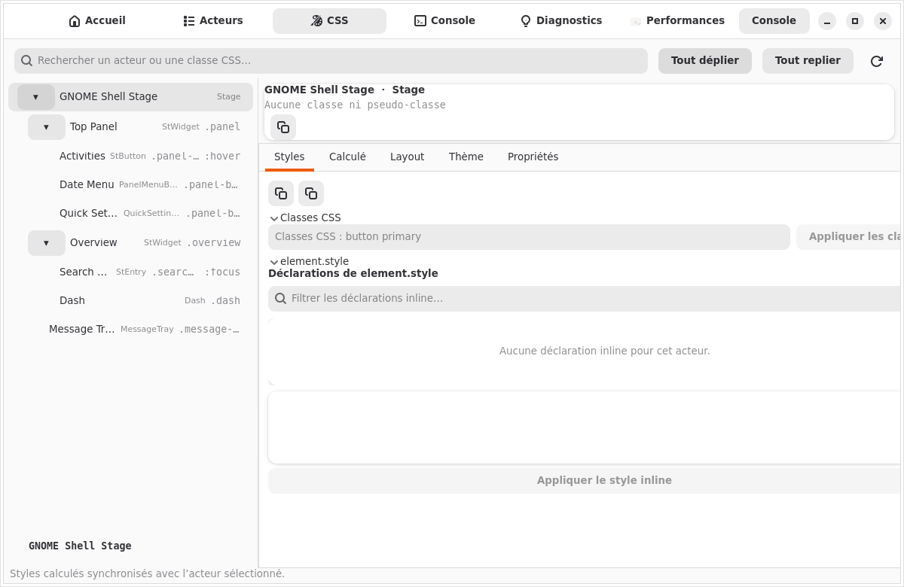
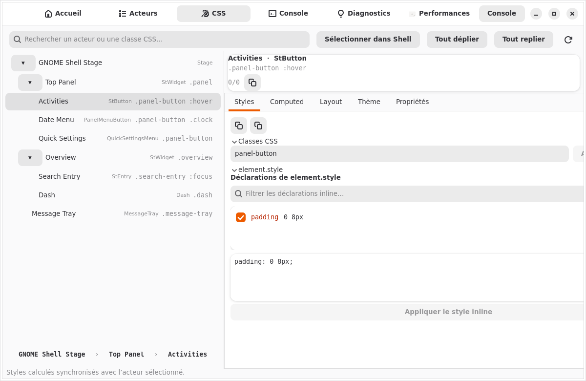
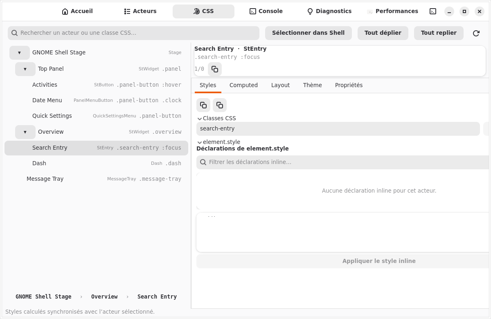
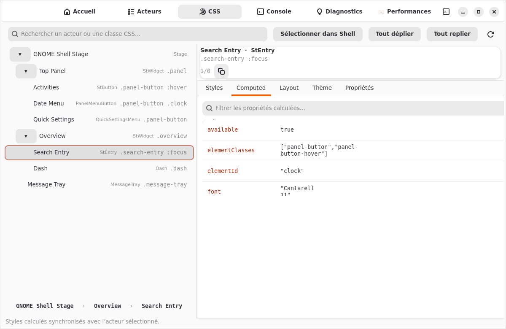
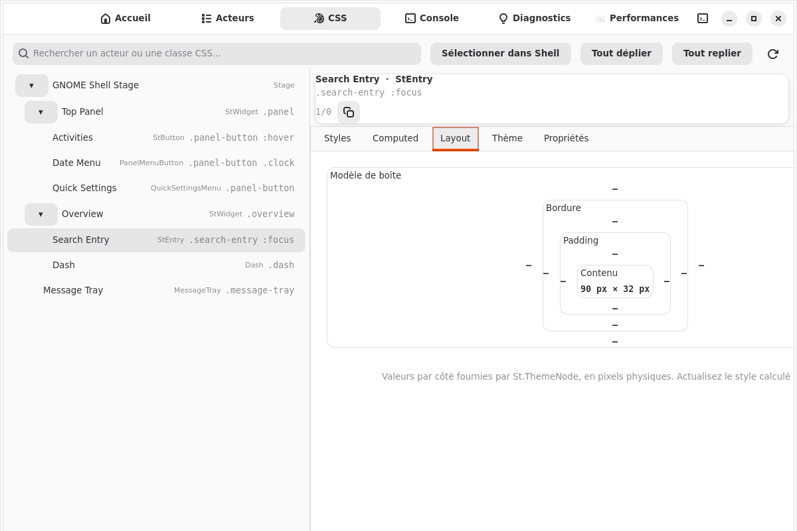
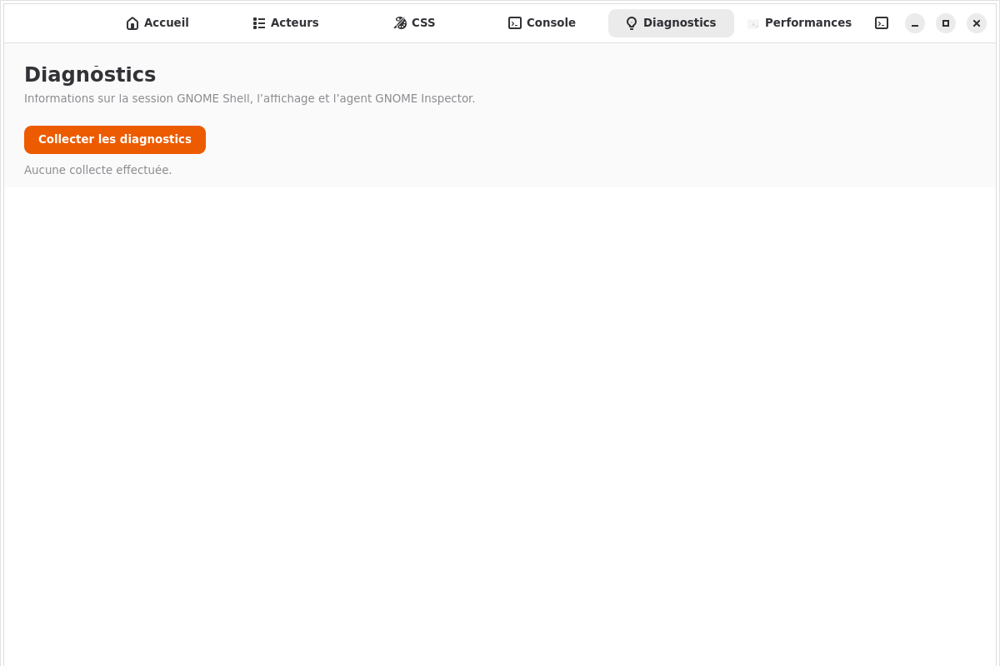
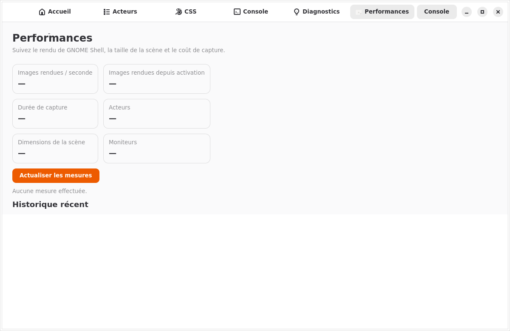

# GNOME Inspector

A native GTK application for inspecting and debugging GNOME Shell.

**Alpha:** `0.1.0-alpha.1` · **Target:** GNOME Shell 51 · **Platform:** Linux

GNOME Inspector consists of a Rust/GTK4/libadwaita desktop app and a GNOME Shell
extension. The extension provides access to Shell-specific APIs over session D-Bus.

## Features

- **Actors:** browse, search and select the Shell actor tree; inspect and edit supported GObject properties.
- **Styles:** inspect actor classes, pseudo-classes and inline CSS; edit declarations and user-owned custom CSS.
- **Computed:** view available theme-node metrics and the box model.
- **Themes:** inspect active stylesheet paths and reload custom stylesheets.
- **GJS console:** run JavaScript in the connected Shell session.
- **Diagnostics:** inspect Shell, session, display and extension information.
- **Performance:** view scene-capture metrics, rendered-frame-rate history, main-thread CPU usage, thread count, context switches, cumulative CPU time and GNOME Shell memory usage.

Inspection is read-only by default. Changes are explicit and limited to supported
properties and user-owned stylesheets. Actor snapshots are bounded and may be
reported as incomplete.

## Screenshots

Captured from the running GTK application in CI. The mock D-Bus service supplies
repeatable sample data; screenshots show the actual application UI.

| View | Screenshot |
| --- | --- |
| Overview |  |
| Actor tree |  |
| Selected actor |  |
| Styles and themes |  |
| Styles: actor tree |  |
| Styles: selected actor |  |
| Styles: nested actor |  |
| Computed values |  |
| Layout |  |
| GJS console |  |
| Diagnostics |  |
| Performance |  |

### Keyboard shortcuts

| Shortcut | Action |
| --- | --- |
| `Ctrl+1` / `Ctrl+2` / `Ctrl+3` | Styles / Computed / Layout |
| `Ctrl+F` | Focus actor search |
| `Ctrl+Shift+C` | Pick an actor in Shell |
| `Esc` | Clear search or cancel selection |

## Install

### Prebuilt alpha

Download the `gnome-inspector-0.1.0-alpha.1-linux-ARCH.tar.gz` archive from
[GitHub Releases](https://github.com/cgreg21/gnome-inspector/releases), extract it,
then run:

```sh
./install.sh
```

The archive includes the app, Shell extension and install/uninstall scripts. Cargo
is not required. GNOME Shell 51 and `gnome-extensions` are required.

To uninstall, run `./uninstall.sh`. User configuration is preserved.

### Build and install from source

Install the native dependencies and Rust stable, then run from the repository root:

```sh
bash scripts/install.sh
```

This builds the app, installs it for the current user and installs/enables the Shell
extension. Launch **GNOME Inspector** from the application menu or run
`gnome-inspector`.

To uninstall:

```sh
bash scripts/uninstall.sh
```

The uninstaller preserves `$XDG_CONFIG_HOME/gnome-inspector`, including
`custom.css`.

To update only the extension from a development checkout:

```sh
bash scripts/install-extension.sh
```

If GNOME Shell has not discovered it yet, log out and back in, then enable it:

```sh
gnome-extensions enable gnome-inspector@cgreg21
```

## Development

### Requirements

- Rust stable and Cargo
- GTK 4 and libadwaita development packages
- GNOME Shell 51 to run the extension

Example native dependencies:

```sh
# Debian / Ubuntu
sudo apt install build-essential pkg-config libgtk-4-dev libadwaita-1-dev

# Fedora
sudo dnf install gcc gcc-c++ make pkgconf-pkg-config gtk4-devel libadwaita-devel

# Arch Linux
sudo pacman -S --needed base-devel pkgconf gtk4 libadwaita
```

For other distributions, install the equivalent GTK 4, libadwaita, C toolchain and
pkg-config development packages. GNOME Shell 51 is needed to run the extension,
not to compile the desktop application.

### Build and run

```sh
cargo build
cargo run
```

### Checks

```sh
cargo fmt --all -- --check
cargo check --all-targets --all-features
cargo test --all-targets --all-features
cargo clippy --all-targets --all-features -- -D warnings
node --test extension/*.test.js
bash scripts/test-install.sh
bash scripts/test-package.sh
bash scripts/test-runtime.sh
bash scripts/test-release-tag.sh
```

CI also runs Rust coverage, dependency audits, ShellCheck, actionlint and a GNOME
Shell 51 integration test.

### GNOME Shell integration test

CI starts an isolated, headless GNOME Shell 51 process with a private D-Bus session.
It installs the extension and tests its D-Bus methods, actor snapshots, CSS access,
diagnostics, GJS evaluation and visual actor picker. This is not a full VM or a
replacement for testing in a normal graphical session.

Run the integration test locally on Fedora 45:

```sh
dbus-run-session -- bash scripts/test-gnome-shell-51.sh
```

## Security and limitations

**GJS console:** commands run inside the connected GNOME Shell process with its
privileges. They can change or disrupt the desktop session and access data available
to Shell. Run only code you trust.

This alpha targets GNOME Shell 51 and currently packages Linux x86_64. CPU usage
and context-switch counters describe the Shell main thread and are read from
`/proc/thread-self/`; RSS, peak RSS and thread count describe the whole Shell process.
Metrics are unavailable when the corresponding procfs data cannot be read.
Global theme stylesheet editing is not implemented. Actor
inspection is bounded and may return incomplete data. See [CHANGELOG.md](CHANGELOG.md) for release
details.

## Roadmap

See [ROADMAP.md](ROADMAP.md) for the current development priorities and
completed milestones.

## Design

- Keep the implementation simple (KISS).
- Rust owns the desktop app and general-purpose logic.
- GJS is limited to Shell-specific APIs.
- Prefer GNOME/GLib APIs over custom infrastructure.
- Mutations must be explicit and tested.

## License

MIT. See [LICENSE](LICENSE).
